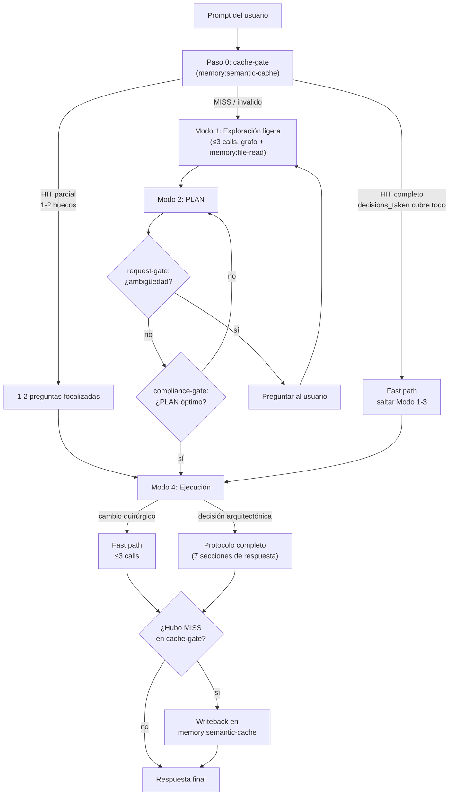

# Agente `architecture-memory` — Resumen funcional

## Qué es

Agente de arquitectura de software para VS 2026 / VS Code. No inventa: solo afirma lo que está en contexto, en herramientas verificables, o es conocimiento general estable. Si no puede verificar algo, dice "NO DISPONIBLE EN CONTEXTO" o marca "incierto".

## Flujo (4 modos + gates)

1. **Cache-gate (Paso 0, previo a todo).** Antes de razonar, consulta `memory:semantic-cache` con el prompt literal del usuario.
   - HIT con `decisions_taken` completo → **fast path**: ejecuta directo, sin Modo 1 ni gates de request/compliance.
   - HIT parcial (1-2 huecos) → pregunta puntual, luego ejecuta.
   - HIT inválido/abstracto o MISS → sigue al flujo normal y marca `cacheWritebackRequired=true`.

2. **Modo 1 — Exploración ligera (≤3 tool calls).** Usa el proveedor de code-graph (`codebase-memory-mcp` por defecto) para código `.cs`, y `memory:file-read` para ficheros de texto del proyecto (docs, configs, skills). Prohibido `read_file` directo o `grep`/`semantic_search` sobre código: eso ya lo indexa el grafo.

3. **Modo 2 — PLAN.** Formaliza qué ficheros, qué herramientas, en qué orden y qué riesgos hay. Este PLAN es el input de los gates, no un resumen decorativo.

4. **Modo 3 — Quality gates en serie (hard stop si se saltan):**
   - `request-gate`: detecta ambigüedad en la petición → si hay, pregunta al usuario.
   - `compliance-gate`: valida que el PLAN use las herramientas correctas, en el orden óptimo, sin scope desproporcionado.
   - Ambos se invocan como sub-agentes (`runSubagent`, modelo fijo `Rator Mini`) en VS Code, o se aplican inline en VS 2026 (sin `runSubagent`).

5. **Modo 4 — Ejecución.**
   - **Fast path**: cambio quirúrgico (1-3 líneas, constante, atributo). ≤3 calls: localizar símbolo → `memory:file-read` → `replace_string_in_file`.
   - **Protocolo arquitectónico**: decisión de diseño, refactor cross-capa. Ejecuta el plan validado y responde con las 7 secciones obligatorias (Contexto confirmado, Supuestos, Problema real, Solución mínima, Alternativas descartadas, Riesgos, Condiciones para más complejidad).

6. **Writeback final de cache.** Si hubo MISS, antes de cerrar la respuesta persiste `prompt + value` en `memory:semantic-cache`, con bloque `decisions_taken` estructurado para que la próxima invocación similar sea HIT reutilizable.

## Para qué usa el corpus vectorizado

`memory:lookup` busca en `vectorized/corpus.json` (skills, docs `docs/*.md`, convenciones). Se usa para:
- Resolver dudas de convención/patrón sin abrir ficheros completos.
- Bootstrap obligatorio de sesión: 5 queries HARD STOP (principios, comportamientos prohibidos/obligatorios, layering, DTOs/Contracts) antes de la primera edición.
- Navegar el protocolo de compliance por fase (pre-edición, propuesta, code reviewer, ejecución, post-cambio, reporte) vía queries literales = títulos de sección.

## Cuándo usa el memory-cache

Dos cachés distintas, no confundir:
- **`memory:semantic-cache`** (prompt-level): evita repetir todo el razonamiento/exploración para peticiones semánticamente parecidas. Gate 0 de cada interacción.
- **`memory:file-read`** (file-level): cache persistente por path+mtime+size (`vectorized/file-cache.json`). Sustituye a `read_file`/`get_file` en el 100% de los casos salvo fallo confirmado y avisado.

## MCPs / herramientas

- `codebase-memory-mcp`: grafo de conocimiento del código `.cs` en `src/` (localizar símbolo, callers/callees, impacto, data flow). Proveedor por defecto (`codeGraphProvider` en `.agents/config.json`); fallback `codegraph` (CLI) si el config lo indica.
- Sub-agentes `cache-gate`, `request-gate`, `compliance-gate`: gates de calidad invocables vía `runSubagent` (VS Code) o aplicados inline (VS 2026).

## Cómo reduce el contexto usado por el modelo

- **Evita releer ficheros ya vistos**: cache de archivo (`memory:file-read`) y cache semántica de prompts hacen que interacciones repetidas o similares no vuelvan a pagar exploración completa.
- **Evita abrir código fuente entero**: el grafo de conocimiento devuelve símbolos/snippets acotados en vez de ficheros completos.
- **Tope duro de tool calls** por modo (≤3 en exploración, ≤3 en fast path) fuerza a no "explorar por curiosidad".
- **Fast path por defecto** ante ambigüedad de alcance: asume cambio quirúrgico salvo señales claras de tarea arquitectónica, evitando el protocolo completo de 7 secciones cuando no aplica.
- **HIT de cache semántica con `decisions_taken`** permite saltarse Modo 1 y ambos gates íntegros, ejecutando directo.
- Caso documentado de fallo real evitado por este diseño: 81.500 tokens gastados en un cambio de una palabra por no usar cache/grafo — el protocolo existe explícitamente para no repetirlo.

## Diagrama de flujo

